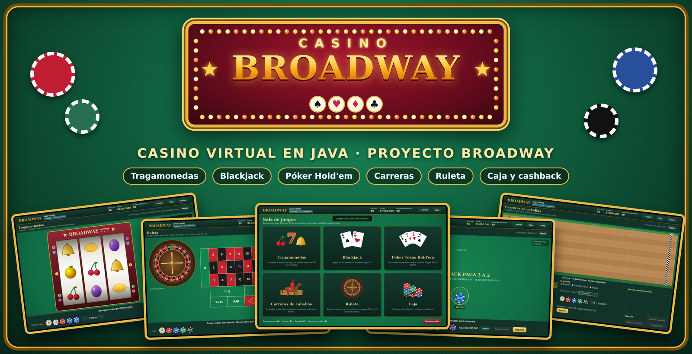
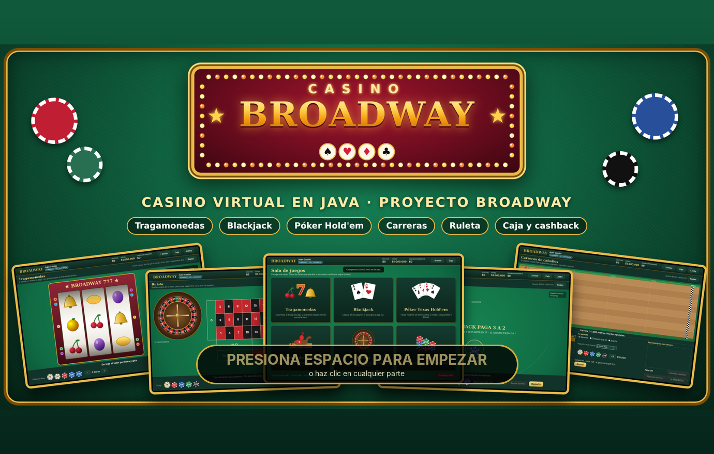
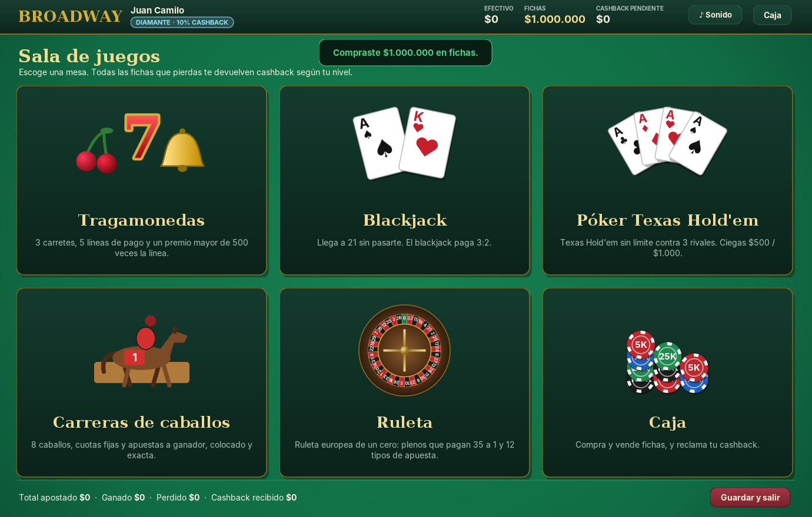
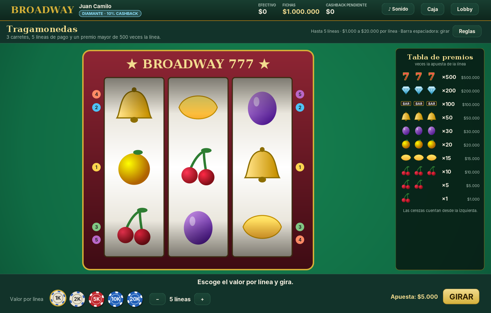
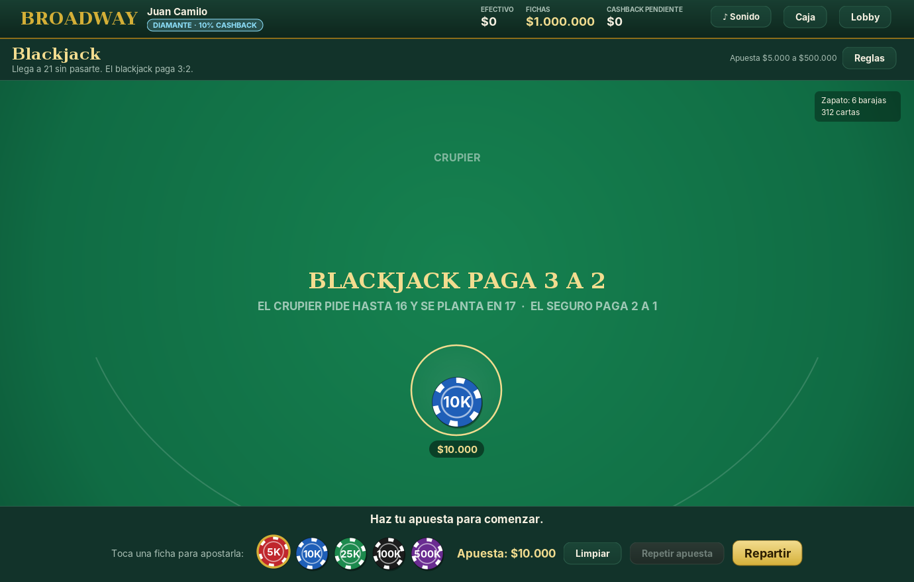
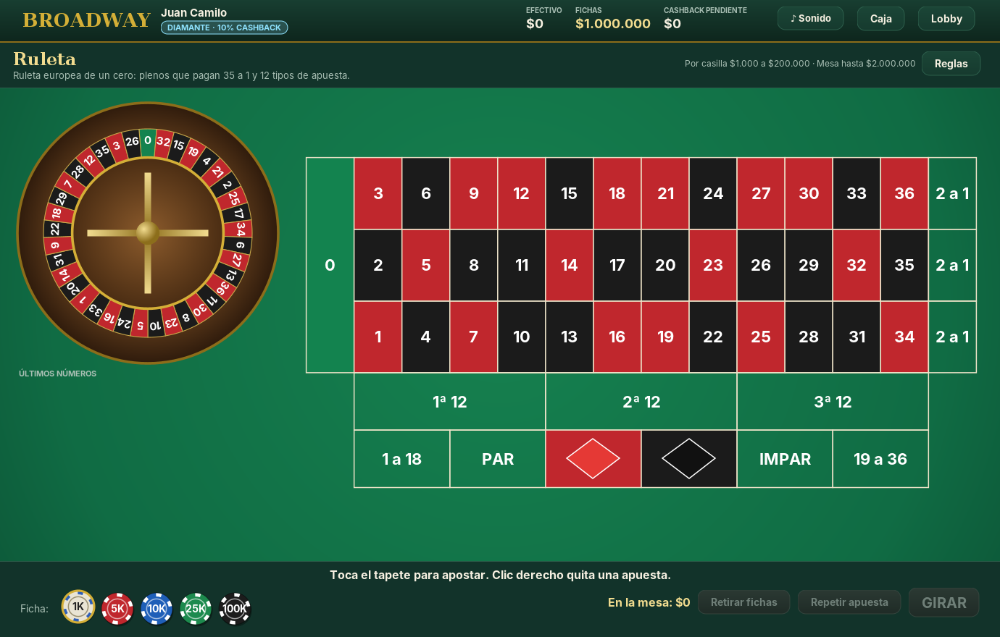
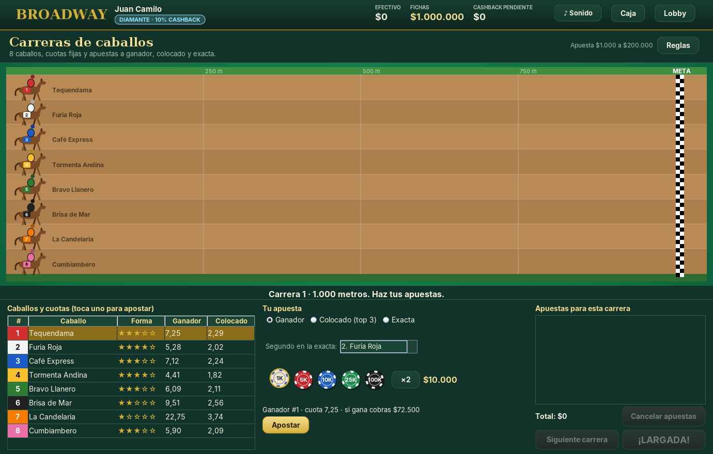
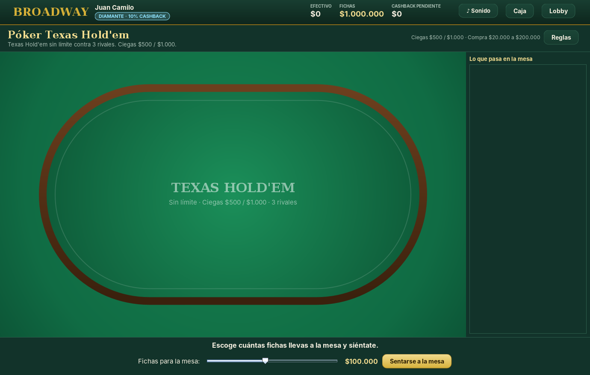
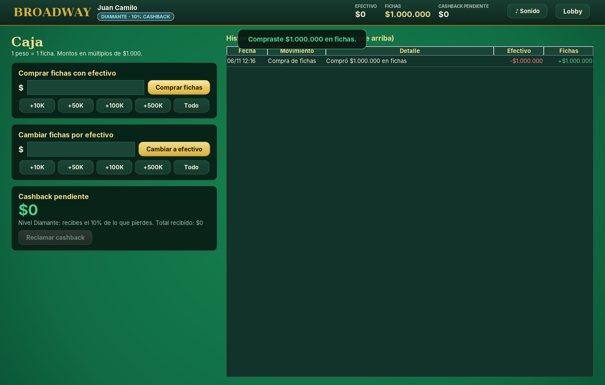

<p align="center"></p>

<p align="center">
  <b>Casino virtual en Java (Swing)</b> · Proyecto Broadway · Programación Orientada a Objetos · Universidad de La Sabana
</p>

## 🎰 Jugar ya

1. Descarga **[`CasinoBroadway.jar`](CasinoBroadway.jar)**.
2. Dale **doble clic** (o en una terminal: `java -jar CasinoBroadway.jar`).
3. En la portada, presiona **ESPACIO** para empezar.
4. Regístrate en la entrada, compra fichas en la caja ¡y a jugar!

> Necesitas **Java 17 o superior** ([Temurin](https://adoptium.net)). Juego virtual con fines académicos: no se usa dinero real.

## 📸 Capturas

| Portada (presiona ESPACIO) | Sala de juegos |
|---|---|
|  |  |
| **Tragamonedas** | **Blackjack** |
|  |  |
| **Ruleta** | **Carreras de caballos** |
|  |  |
| **Póker Texas Hold'em** | **Caja** |
|  |  |

---


Casino virtual con interfaz gráfica (Swing) que representa al Casino Broadway. Incluye:

| Sala | Qué tiene |
|---|---|
| **Tragamonedas** | 3 carretes, 3 filas, hasta 5 líneas de pago, tabla de premios real (premio mayor 500×). Retorno teórico al jugador: 94,4 %. |
| **Blackjack** | Zapato de 6 barajas, blackjack 3:2, crupier se planta en 17, seguro 2:1, doblar, dividir (hasta 4 manos) y rendirse. |
| **Póker Texas Hold'em** | Sin límite contra 3 rivales de la computadora, ciegas $500 / $1.000, botón rotativo, quema de cartas, subida mínima, botes secundarios. |
| **Carreras de caballos** | 8 caballos, cuotas fijas calculadas simulando 20.000 carreras, apuestas a ganador, colocado y exacta. Carrera animada. |
| **Ruleta europea** | Un solo cero, rueda animada y tapete completo: pleno, semipleno, calle, cuadro, seisena, docena, columna y sencillas. |
| **Caja** | Compra y venta de fichas (1 peso = 1 ficha), cobro del cashback e historial de movimientos. |

Al abrir el juego aparece la **portada**: se presiona **ESPACIO** (o se hace clic) para pasar a la entrada. Ahí el jugador se registra (con validación de mayoría de edad) y **escoge su nivel de fidelidad**:

| Nivel | Cashback sobre las fichas perdidas |
|---|---|
| Bronce | 2 % |
| Plata | 4 % |
| Oro | 8 % |
| Diamante | 10 % |

El cashback se acumula ronda a ronda (en el póker, al levantarse de la mesa) y se reclama en la caja.

**Sonidos de casino:** fichas, cartas repartidas, carretes girando y frenando, la bola de la ruleta rebotando,
la corneta y el galope de las carreras, el público en la llegada, la caja registradora y fanfarrias de premio.
Todos se generan con código (no hay archivos de audio) y se pueden silenciar con el botón **♪ Sonido** de la barra superior.

La partida (efectivo, fichas, cashback e historial) se guarda en `datos/partida.dat` y se puede continuar al volver a abrir el programa.

---

## Requisitos

- **JDK 17 o superior** (recomendado: Temurin 21, <https://adoptium.net>).
- No usa librerías externas: todo es Java estándar.

## Abrirlo en Visual Studio Code

1. Instala la extensión **Extension Pack for Java** (VS Code la recomienda sola al abrir la carpeta).
2. `Archivo → Abrir carpeta…` y escoge la carpeta `CasinoBroadway`.
3. Espera a que la barra de abajo diga que el proyecto Java está listo.
4. Abre `src/broadway/Main.java` y pulsa **Run** (o `F5` y escoge **Casino Broadway**).

La configuración ya viene en `.vscode/` (carpeta de código `src`, codificación UTF-8 y la configuración de ejecución).

## Abrirlo en IntelliJ IDEA

1. `File → Open…` y escoge la carpeta `CasinoBroadway`.
2. Si aparece el aviso *Project JDK is not defined*, pulsa **Setup SDK** y escoge tu JDK 17 o superior
   (o descárgalo desde ahí mismo).
3. Arriba a la derecha ya está la configuración **Casino Broadway**: pulsa ▶.

La configuración ya viene en `.idea/` y `CasinoBroadway.iml`.

## Sin IDE

- Windows: doble clic en `ejecutar.bat`.
- macOS / Linux: `./ejecutar.sh`.

---

## Estructura

```
src/broadway/
├── Main.java                  Punto de entrada
├── Casino.java                Reúne la caja, los juegos y el jugador
├── modelo/                    Jugador, NivelFidelidad, Caja, Movimiento, ResultadoRonda...
├── cartas/                    Carta, Palo, Valor, Baraja (compartidas por blackjack y póker)
├── juegos/
│   ├── Juego.java             Clase abstracta base de todos los juegos
│   ├── Apuesta.java           Interfaz genérica de las apuestas (ruleta y carreras)
│   ├── tragamonedas/          Tragamonedas, Simbolo, ResultadoGiro, LineaPremiada
│   ├── blackjack/             Blackjack, ManoBlackjack, EstadoBlackjack
│   ├── poker/                 PokerTexasHoldem, EvaluadorPoker, EstrategiaRival y sus 3 estilos...
│   ├── carreras/              CarreraCaballos, Caballo, SimulacionCarrera, ApuestaCarrera...
│   └── ruleta/                Ruleta, ApuestaRuleta, TipoApuestaRuleta, ResultadoTirada
├── persistencia/              GestorArchivos (guarda y carga la partida)
├── sonido/                    ServicioSonido, SonidoActivo, SonidoSilenciado, Sintetizador, Efecto
└── vista/                     Ventana y pantallas Swing (todo dibujado con Java2D, sin imágenes)
```

La lógica de los juegos (`modelo`, `cartas`, `juegos`) no depende de la interfaz: se puede probar sin abrir ninguna ventana.

## Decisiones de POO

### Interfaces (cada una con al menos dos implementaciones)

| Interfaz | Implementaciones | Para qué sirve |
|---|---|---|
| `Apuesta<R>` (genérica) | `ApuestaRuleta` (`R = Integer`, el número que salió), `ApuestaCarrera` (`R = int[]`, el orden de llegada) | `Juego.liquidarApuestas` paga cualquier lista de apuestas sin saber de qué juego son. |
| `EstrategiaRival` | `RivalConservador`, `RivalEquilibrado`, `RivalAgresivo` (a través de la clase abstracta `EstrategiaBase`) | La mesa de póker le pregunta a cada rival qué hace; cada estilo decide distinto. |
| `ServicioSonido` | `SonidoActivo`, `SonidoSilenciado` | El botón de sonido solo cambia de objeto; nadie tiene que preguntar "¿está en silencio?". |

### Polimorfismo

- **`Juego` es abstracta** y la heredan los cinco juegos. El lobby los recorre sin saber cuál es cada uno
  (`getDescripcion()`, `getReglas()`).
- **`apuesta.calcularPremio(resultado)`**: un pleno, un semipleno o una exacta calculan su premio de forma distinta,
  pero `Juego` los paga con el mismo ciclo.
- **`estrategia.decidir(situacion)`**: el mismo llamado hace que un rival conservador se retire y uno agresivo suba.
- **`PanelJuego` es abstracta** en la vista: al cerrar la ventana se llama `prepararCierre()` en todas las pantallas
  y cada una hace lo suyo (el póker te levanta de la mesa, la ruleta devuelve las fichas...).

### Clases anidadas

| Clase | Tipo | Por qué está anidada |
|---|---|---|
| `PokerTexasHoldem.Bote` | anidada estática | Un bote (principal o secundario) solo existe dentro de una mano de póker. |
| `EstrategiaRival.Situacion` y `EstrategiaRival.Decision` | `record` anidados | Son lo que entra y lo que sale de una decisión; solo tienen sentido junto a la interfaz. |
| `ServicioSonido.Reproduccion` | interfaz anidada | Un sonido en curso que se puede detener. |
| `SonidoActivo.Voz` | interna (no estática) | Cada sonido de la mezcla; usa la lista y el candado del mezclador que la contiene. |
| `PanelRuleta.Tapete`, `PanelBlackjack.Mesa`, `PanelCarreras.Pista`... | internas | Dibujan leyendo el estado del juego de la pantalla que las contiene. |
| `PanelLobby.Tarjeta`, `VentanaPrincipal.Aviso` | anidadas estáticas | Componentes visuales que solo usa esa pantalla. |

### Otras decisiones

- **El saldo del jugador está encapsulado.** `Jugador` no tiene `setFichas`: las fichas solo cambian con
  `apostar`, `cobrar`, comprar y vender, y cada operación valida (sin montos negativos ni apuestas mayores al saldo).
- **`NivelFidelidad` es un `enum`** con el porcentaje de cashback: el nivel es un dato del jugador, no un tipo distinto de jugador.
- **Excepción propia `OperacionInvalidaException`** para toda regla que se incumple; su mensaje se muestra tal cual al jugador.
- **Métodos de fábrica que validan** (`ApuestaRuleta.semipleno(17, 20, monto)` rechaza números que no son vecinos en el tapete).
- **`GestorArchivos` es la única clase que toca archivos**: si cambia el formato, solo cambia esa clase.

## Verificación

Las reglas se probaron simulando miles de rondas:

- Tragamonedas: retorno simulado 94,8 % frente al 94,4 % teórico.
- Ruleta: pagos de los 12 tipos de apuesta comprobados con el número 17 y con el 0.
- Blackjack: 40.000 manos con divisiones, dobles, seguros y rendiciones; las fichas siempre cuadran.
- Póker: el evaluador rápido coincide con el exacto en 300.000 manos; 600 manos completas sin perder ni crear fichas (incluidos los botes secundarios).
- Carreras: retorno de las apuestas a ganador cercano al 85 % esperado (15 % de margen de la casa).

> Juego virtual con fines académicos. No se usa dinero real.
