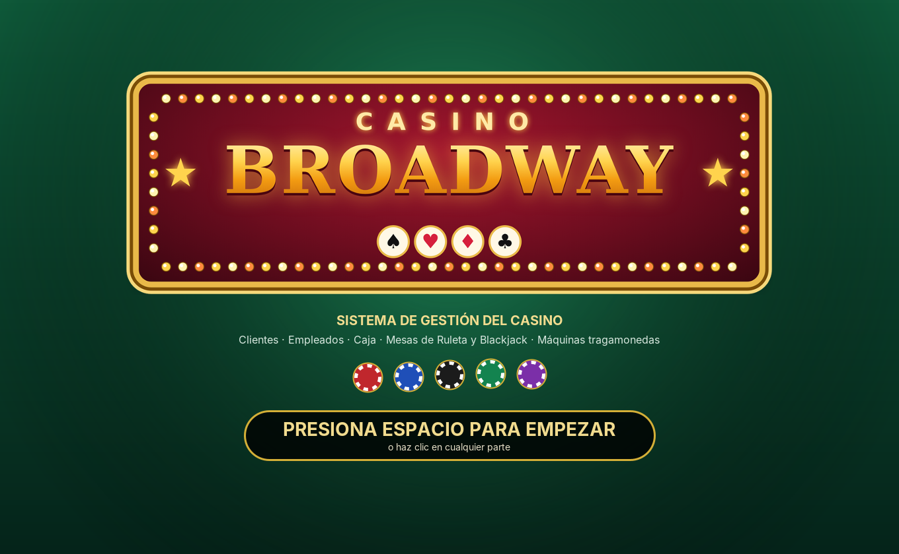

# Guía de Casino Broadway

<p align="center"></p>

## Ejecutar el casino

Abre [`CasinoBroadway.jar`](../CasinoBroadway.jar) con Java 17 o superior. También puedes ejecutar `java -jar CasinoBroadway.jar` desde la raíz del proyecto. Pulsa **Espacio** en la portada y selecciona una cuenta de prueba en el inicio de sesión.

| Cargo | Usuario | Contraseña | Funciones |
|---|---|---|---|
| Administrador | `admin` | `admin123` | Registra empleados, gestiona las mesas y consulta los clientes. |
| Cajero | `cajero` | `cajero123` | Registra clientes, vende y canjea fichas, entrega cashback y maneja los turnos de caja. |
| Crupier | `crupier` | `crupier123` | Atiende sus mesas de ruleta y blackjack y opera la sala de tragamonedas. |
| Técnico de máquinas | `tecnico` | `tecnico123` | Registra máquinas, las pone en mantenimiento y las vuelve a poner en servicio. |

## Juegos

| Juego | Operación |
|---|---|
| Ruleta | El crupier registra apuestas de los clientes, gira la rueda europea y liquida la ronda. |
| Blackjack | El crupier reparte las cartas y liquida la mano. El blackjack natural paga 3 a 2. |
| Tragamonedas | La máquina descuenta el costo del giro. Tres símbolos iguales pagan diez veces el costo. |

La aplicación inicia con datos de demostración. Los registros y las transacciones de la sesión se mantienen en memoria.

## Requisitos

- **JDK 17 o superior** (recomendado: Temurin 21, <https://adoptium.net>).
- No usa librerías externas: todo es Java estándar.

## Abrirlo en Visual Studio Code

1. Instala la extensión **Extension Pack for Java**.
2. `Archivo → Abrir carpeta…` y escoge la carpeta `CasinoBroadway`.
3. Espera a que la barra de abajo diga que el proyecto Java está listo.
4. Abre `src/Main.java` y pulsa **Run**.

## Abrirlo en IntelliJ IDEA

1. `File → Open…` y escoge la carpeta `CasinoBroadway`.
2. Si aparece el aviso *Project JDK is not defined*, pulsa **Setup SDK** y escoge tu JDK 17 o superior
   (o descárgalo desde ahí mismo).
3. Arriba a la derecha ya está la configuración **Casino Broadway**: pulsa ▶.

La configuración ya viene en `.idea/` y `CasinoBroadway.iml`.

## Sin IDE

- Windows: doble clic en `ejecutar.bat`.
- macOS / Linux: `./ejecutar.sh`.

---

## Estructura

```text
src/
├── enums/        Reservada para enumeraciones independientes
├── files/        Imagen utilizada en la portada y el acceso
├── interfaces/   Operable
├── modelos/      Dominio del diagrama UML
├── persistencia/ Reservada para RF-11
├── repositorios/ Reservada para repositorios
├── servicios/    Datos iniciales y formato de dinero
├── ui/           Pantallas Swing de los cuatro cargos
└── Main.java     Punto de entrada
```

## Correspondencia con el UML

- `Persona` es la base abstracta de `Cliente` y `Trabajador`. Los cuatro cargos definen sus permisos mediante `puedeRealizar(String)`.
- `Casino` reúne los clientes, trabajadores, mesas, máquinas y juegos, y posee una `Caja`.
- `Mesa` y `MaquinaTragaMoneda` implementan `Operable`. Cada mesa tiene un juego y un crupier asignado, y cada ronda aplica el cupo de la mesa.
- `Juego.calcularPremio(double)` es abstracto. `Ruleta` y `Blackjack` lo implementan con pagos distintos y `Apuesta` delega el cálculo al juego.
- `Caja.CierreTurno`, `Cliente.NivelFidelidad` y `MaquinaTragaMoneda.RondaMaquina` se declaran dentro de la clase correspondiente.

[Diagrama UML](Diagrama%20UML.png) · [Correspondencia de clases y requerimientos](../README.md#correspondencia-uml--código)
